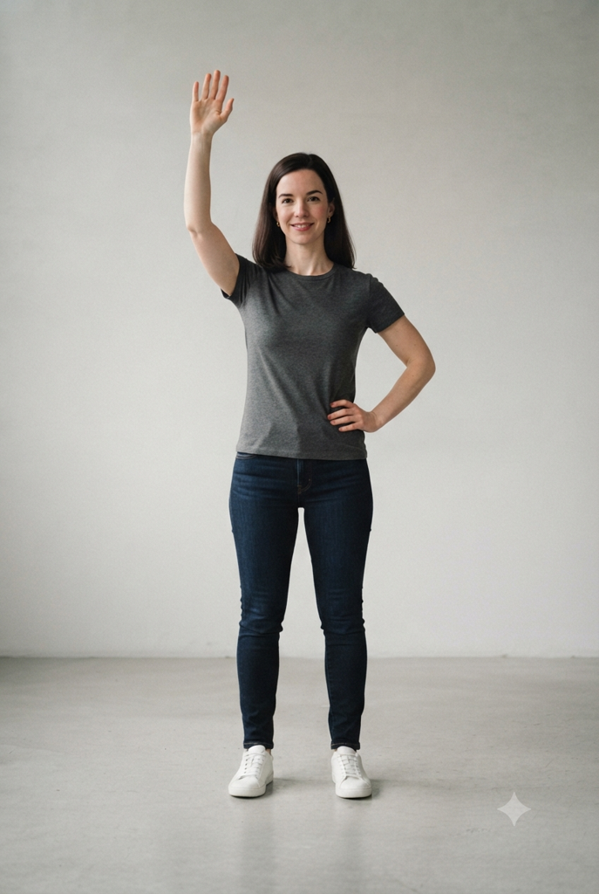
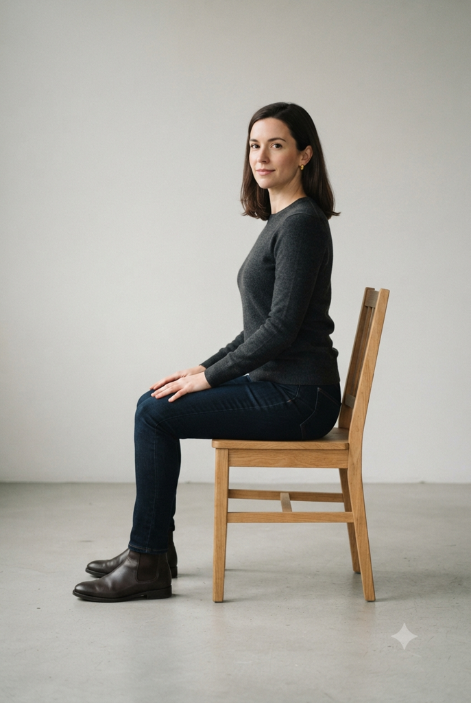
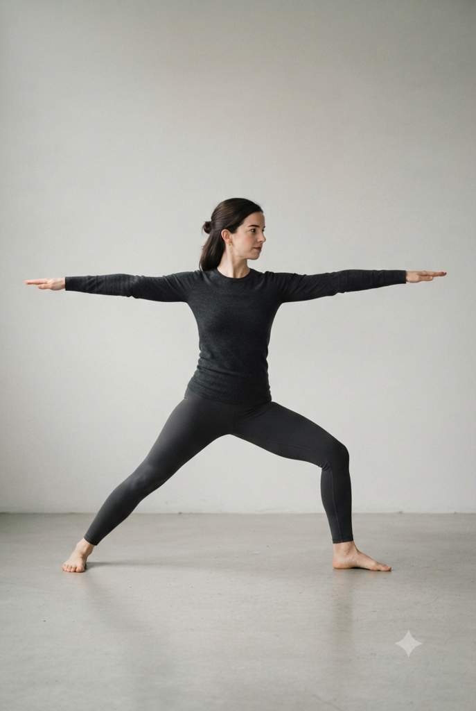
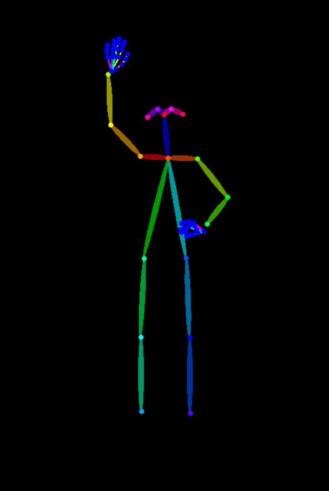
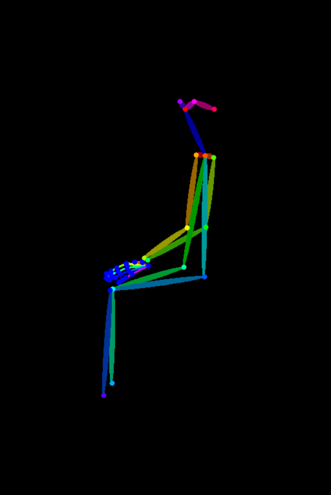
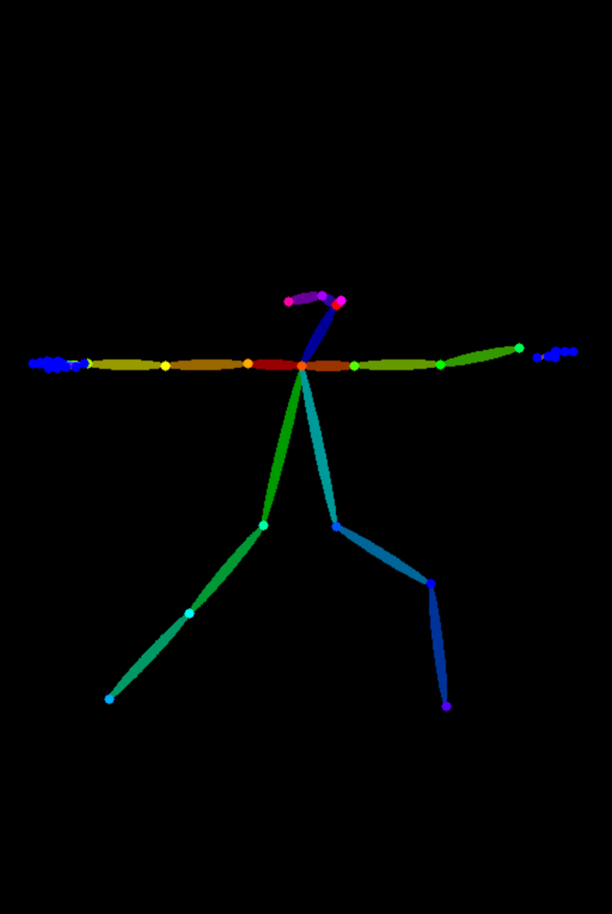
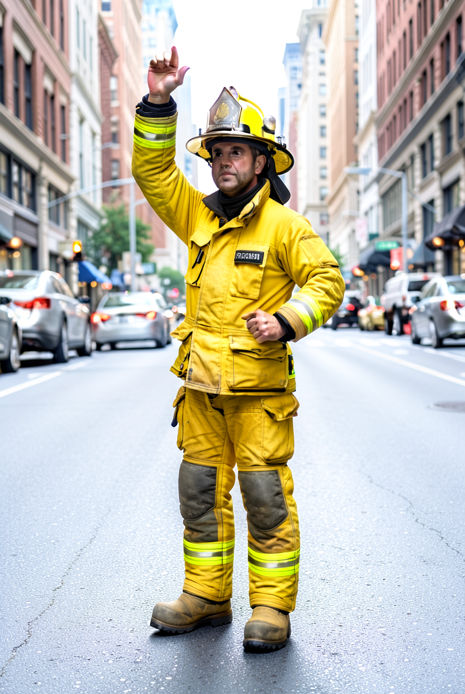
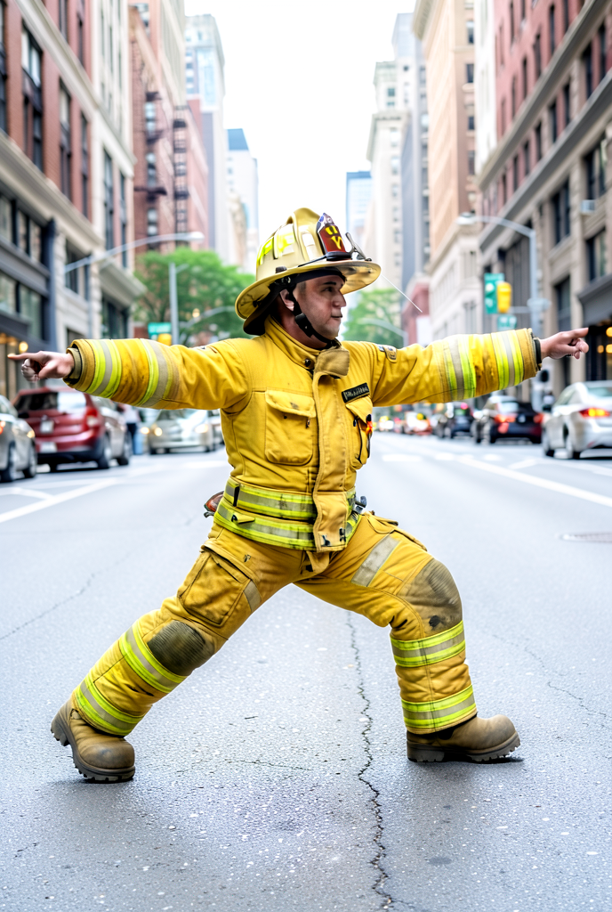

# 원하는 포즈로 이미지 만드는 도구

[](https://colab.research.google.com/github/k-im-rose/pose-image-tool/blob/main/pose_tool.ipynb)

## 도구 설명
- 참조 사진에서 OpenPose로 관절 뼈대를 뽑고, 그 뼈대를 포즈 조건으로 넣어 **같은 자세의 다른 인물·장면**을 만듭니다.
- 모델은 FLUX.2-klein 4B(GGUF Q4, Apache 2.0)이고 ComfyUI에서 돌립니다. 교안의 FLUX.2-klein 4B Colab 노트가 출발점입니다.
- FLUX.2에는 공식 ControlNet이 없어서, 뼈대 그림을 klein의 **참조 이미지(ReferenceLatent)** 로 넣고 프롬프트로 "같은 자세로" 지시합니다.
- 비교용으로 SD 1.5 + OpenPose ControlNet 셀도 부록에 있습니다.

```
참조 사진 → OpenPose → 뼈대 그림 ─┐
                                  ├→ FLUX.2-klein 4B → 같은 자세의 새 이미지
프롬프트 ─────────────────────────┘
```

## 사용법
1. 위 **Open in Colab** 버튼(또는 GitHub의 `pose_tool.ipynb`)으로 노트를 엽니다.
2. [런타임 → 런타임 유형 변경 → T4 GPU]로 바꿉니다.
3. 셀을 위에서부터 순서대로 실행합니다: 설치 → 모델 다운로드 → 서버 실행 → 사진 올리기 → **포즈 추출 → 생성 → 저장**.
4. 마지막 셀이 `samples/` 와 `prompts.md` 를 zip으로 내려 줍니다.

## 폴더 구조
```
pose-image-tool/
├── README.md          # 이 문서
├── pose_tool.ipynb    # Colab 튜토리얼 노트 (핵심)
├── samples/
│   ├── pose_01.png            # 참조로 쓴 포즈 이미지
│   ├── pose_01_skeleton.png   # OpenPose가 뽑은 뼈대
│   ├── output_01.png          # 같은 자세로 만든 결과
│   ├── output_01_nopose.png   # 비교: 포즈 조건 없이 같은 프롬프트
│   ├── expA_*.png             # 실험 A: 같은 포즈, 다른 프롬프트
│   └── expB_*.png             # 실험 B: 다른 포즈, 같은 프롬프트
└── prompts.md         # 테스트에 쓴 프롬프트·시드·설정 기록 (노트가 자동 생성)
```

## 테스트 결과
Colab 무료 T4에서 직접 실행했습니다. 시드 42 고정, 4스텝, cfg 4.0. 프롬프트 전체는 [prompts.md](prompts.md)에 있습니다.

| | 포즈 1: 서서 한 팔 들기 | 포즈 2: 의자에 옆으로 앉기 | 포즈 3: 요가 전사 자세 |
|---|---|---|---|
| 참조 사진 |  |  |  |
| 뼈대 |  |  |  |
| 결과 (소방관) |  |  |  |
| 결과 (회사원) |  |  |  |

- 포즈 1: 한 손 든 자세 → 프롬프트: a firefighter … standing in a city street → 결과: 든 팔의 방향과 높이는 맞았습니다. 허리를 짚은 왼손은 가슴·배 앞으로 올라왔습니다.
- 포즈 2: 의자에 앉은 옆모습 → 프롬프트: a businessman in a navy suit in a modern office → 결과: 앉은 자세는 따랐지만 의자가 사라져 공중에 앉은 그림이 됐습니다.
- 포즈 3: 요가 전사 자세 → 같은 프롬프트 → 결과: 팔 높이, 다리 폭, 무릎 방향, 돌린 고개까지 가장 정확하게 맞았습니다.
- 포즈 조건을 끄면 같은 시드에서 세 장 모두 똑같이 차렷 자세로 나왔습니다 (`output_0N_nopose.png`). 자세를 바꾼 것은 뼈대뿐입니다.
- 같은 포즈에 프롬프트만 바꾸면(`expA_*.png`: 우주비행사, 요리사, 수채화 소녀) 인물·배경·화풍은 바뀌고 든 팔 자세는 유지됐습니다.

## 한계
- 뼈대에는 사람 관절만 담겨서 의자 같은 물건은 사라집니다. 물건이 필요한 자세는 프롬프트에 직접 적어야 합니다.
- 손 모양은 약하게 따라옵니다. 편 손바닥이 주먹으로 바뀌는 경우가 많았습니다.
- 옆모습 사진은 가려진 팔·다리가 뼈대에서 빠져 결과가 불안정합니다.
- 프롬프트 내용이 자세와 부딪히면(앉은 뼈대 + standing) 어정쩡한 중간 자세가 나옵니다.
- 포즈 조건을 켜면 한 장에 약 37초로, 끌 때(약 19초)보다 두 배쯤 걸립니다.

자세한 관찰은 `pose_tool.ipynb` 의 마지막 셀에 있습니다.

## 라이선스 메모
- FLUX.2-klein 4B는 Apache 2.0이라 상업 이용도 됩니다. 단 결과물 속 타인의 초상·저작물 권리까지 해결해 주지는 않습니다.
- 같은 이름의 FLUX.2-klein 9B는 비상업 전용입니다.
- `samples/` 의 참조 사진(`pose_0N.png`)은 Google Gemini로 만든 가상 인물 이미지입니다. 실제 인물이 아닙니다.
